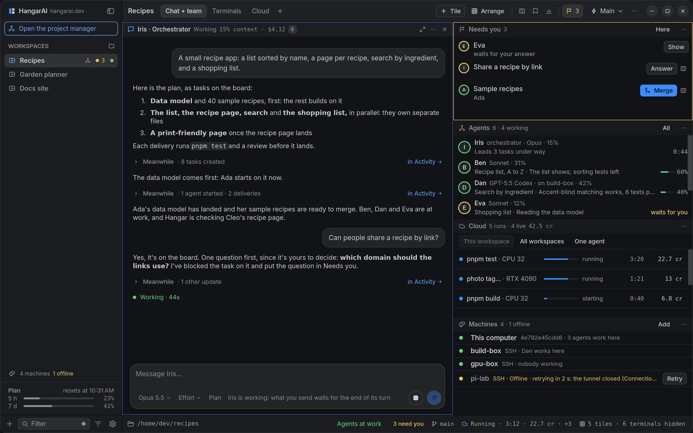

  

<h1 align="center">HangarAI</h1>

  <b>Run a team of coding agents in one native window, and steer them from your phone.</b> 
  Claude Code and Codex (beta), side by side. Either one is enough.

  
  

  <a href="#install">Download</a> ·
  <a href="docs/guide/README.md">Guide</a> ·
  <a href="CHANGELOG.md">Changelog</a> ·
  <a href="https://hangarai.dev">Website</a> ·
  <a href="https://discord.gg/hangarai">Discord</a>

HangarAI is a native desktop app (Rust, no Electron) that runs the coding agents already on
your machine — Claude Code and Codex (beta), either one or both — as many sessions as you
need, with a shared board, a shared memory and an orchestrator. No usage telemetry; the
optional HangarAI account and what it sends are described on the
[privacy page](https://hangarai.dev/privacy.html).

This repository holds HangarAI's releases, its user guide, its website and its issue
tracker. The source code is not public.

## What it does

- 🖥️ **Many agents, one window.** Up to 16 terminals per workspace, Claude Code, Codex or any
  shell, each showing whether its agent is working, waiting for you, or done.
- 📋 **A shared board and memory over MCP.** Agents claim tasks atomically, leave notes,
  and record what the next session should know.
- 🧭 **Orchestrator and workers, of either agent.** One agent plans, Claude Code or Codex;
  workers, of the same agent or the other, each get a git worktree and a branch. Every
  delivery is merged in a scratch worktree, run through your check command, read by a
  reviewer agent, then landed locally. Hangar never pushes.
- 🤝 **Delegate.** An agent hands a sub-task to the other one — a review, a question about
  the repository, a set of images — and gets the result back, with no board task.
- 🎨 **Images from Codex.** What a Codex session draws shows in the chat, on your phone and
  on Discord; a Claude Code orchestrator can ask Codex for images and use the files.
- 📱 **Hangar Mobile.** See what waits for you, answer your agents' questions with a tap,
  allow or deny permissions — from your phone, over your own Tailscale network or, with a paid
  license, from anywhere through HangarAI's end-to-end encrypted relay.
- 🧩 **Kits and previews.** Kits add skills, MCP servers and tabs of their own; agents show
  you images, code, Markdown, PDFs, web pages, video and 3D models beside their terminal.
- ☁️ **Cloud Builds.** A check or a build on a 32-thread machine rented for you alone, then
  destroyed: from the palette, from a terminal (`hangar-ai cloud run`), or every delivery's
  check. Paid with your credits at the machine's rate, shown before it starts; Pro runs 3 at
  once, Max 5, first in the queue.
- 🖼️ **Image generation.** Claude Code and Codex draw or edit an image for you, from a quick
  draft to the best quality, paid with your credits; it opens beside the terminal.
- 🔗 **Share links.** You or an agent publish a page, a PDF, an image or a 3D model at
  hangarai.dev for 30 days, from its pane, with a code to open it on a phone.
- 🎙️ **Dictation.** Hold a key and speak. It is hosted, paid with your HangarAI credits: the
  audio goes to HangarAI's server, then to Groq to be transcribed, and is not stored.

More: [features](docs/guide/features.md) · [orchestration](docs/guide/orchestration.md) ·
[Codex (beta)](docs/guide/codex.md) · [MCP tools](docs/guide/mcp.md) · [privacy](docs/guide/privacy.md)

## Claude Code and Codex

Hangar asks each agent what it can do, never which agent it is, so every feature works with
either one alone, and says so where one does less:

| | Claude Code | Codex (beta) |
|---|---|---|
| Orchestrator, workers, project manager | yes | yes |
| Delivery reviewer | `claude -p` | `codex exec`, read-only |
| Chat view, answers from Mobile and Discord | yes | yes; keys checked on screen when Hangar cannot attach |
| Context gauge, plan limits | yes | yes, exact, with their reset times |
| Several accounts | yes | yes |
| Kits | everything | MCP servers; skills and hooks once added to Codex; commands and agents: Claude Code only |
| Usage statistics | yes | yes |
| Generates images | no | yes |
| `delegate`, as the one asked | yes | yes |

The full table, and what Hangar does when it cannot attach to Codex: [Codex (beta)](docs/guide/codex.md).

Codex support is **beta** until its users confirm it. Hangar was written against the protocol
OpenAI publishes for Codex, without a recorded session, and relies on a few things only
Codex's source shows: that Codex's own terminal draws a turn Hangar started, that it resumes
a session through Hangar's server, that the first of two answers to an approval wins, and how
an image is written in its newer session files. On Windows, Codex panes run without Hangar
attached ([what that changes](docs/guide/codex.md#attached-or-the-plain-terminal)).
Something wrong in a Codex pane? Use the
[Codex bug form](https://github.com/hangar-ai/hangar/issues/new?template=codex-bug.yml).

## Install

Grab the file for your system from the
**[latest release](https://github.com/hangar-ai/hangar/releases/latest)** (under
**Assets**). After that, HangarAI updates itself in one click.

| System | File |
|---|---|
| Windows (x64) | `Hangar.AI_<version>_x64-setup.exe` — per-user, no admin rights |
| Linux (x86_64) | `.AppImage` (glibc 2.35+, `chmod +x` it), `.deb` or `.rpm` |
| macOS | `Hangar.AI_<version>_universal.dmg` — Apple Silicon and Intel, signed and notarised, macOS 10.15+ |

HangarAI starts with a 14-day free trial, no card asked. Then **HangarAI Pro**, 20 € a month or
192 € a year, or **HangarAI Max**, 39 € a month or 374 € a year, for more than three times the
credits of the hosted features; VAT included, see the
[pricing](https://hangarai.dev/pricing/). Installs of 2.5.1 and earlier keep HangarAI for free.

You also need [Claude Code](https://code.claude.com/docs/en/overview) or
[Codex](https://developers.openai.com/codex) installed and signed in (HangarAI's first-run
sheet installs either one for you). Then create a workspace (`Ctrl`/`Cmd`+`Shift`+`N`): it
starts with one agent pane, its orchestrator. Tell it what you want built.

More: [install guide](docs/guide/install.md) · [Hangar Mobile](docs/guide/mobile.md) ·
[changelog](CHANGELOG.md).

## Bugs and ideas

[Open an issue](https://github.com/hangar-ai/hangar/issues/new/choose) — there is a form for
bugs, one for Codex (beta) and one for ideas — or come to
[Discord](https://discord.gg/hangarai). Security issues: [SECURITY.md](SECURITY.md).

## 💝 Contributors

<table>
  <tr>
    <td align="center" width="25%">
       
      <b>simnJS</b> 
      <i>Creator</i> 
      He/Him/Femboy 
      <a href="https://simnjs.fr">Website</a> / <a href="https://github.com/simnJS">GitHub</a>
    </td>
    <td align="center" width="25%">
       
      <b>Kisakay</b> 
      <i>Contributor · NixOS</i> 
      She/Her 
      <a href="https://github.com/Kisakay">GitHub</a>
    </td>
    <td align="center" width="25%">
       
      <b>McSon2</b> 
      <i>Contributor · macOS</i> 
      He/Him 
      <a href="https://github.com/McSon2">GitHub</a>
    </td>
    <td align="center" width="25%">
       
      <b>SimonB44470</b> 
      <i>Contributor · Accounts</i> 
      He/Him 
      <a href="https://github.com/SimonB44470">GitHub</a>
    </td>
  </tr>
</table>

## License

HangarAI is proprietary software, © simnJS. All rights reserved: see [LICENSE](LICENSE).
Versions up to 2.5.1 were published under the MIT license, which still applies to those
versions.
