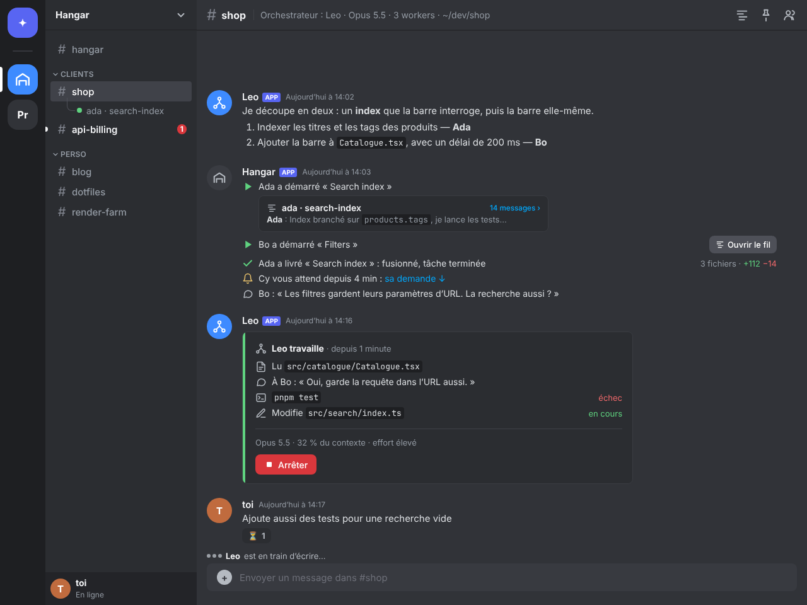
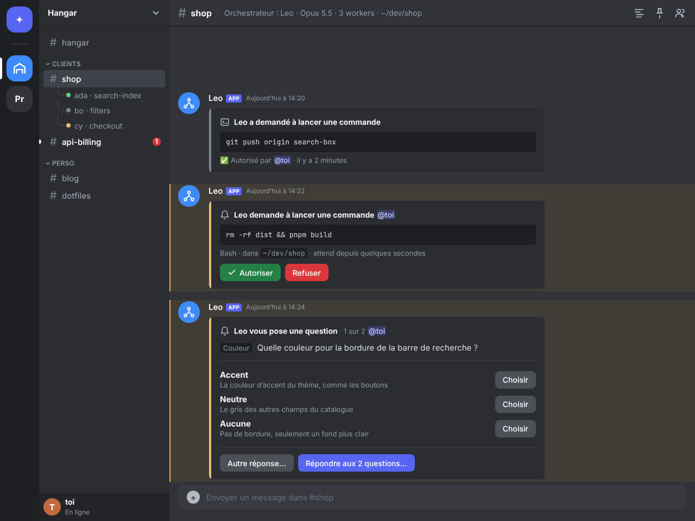
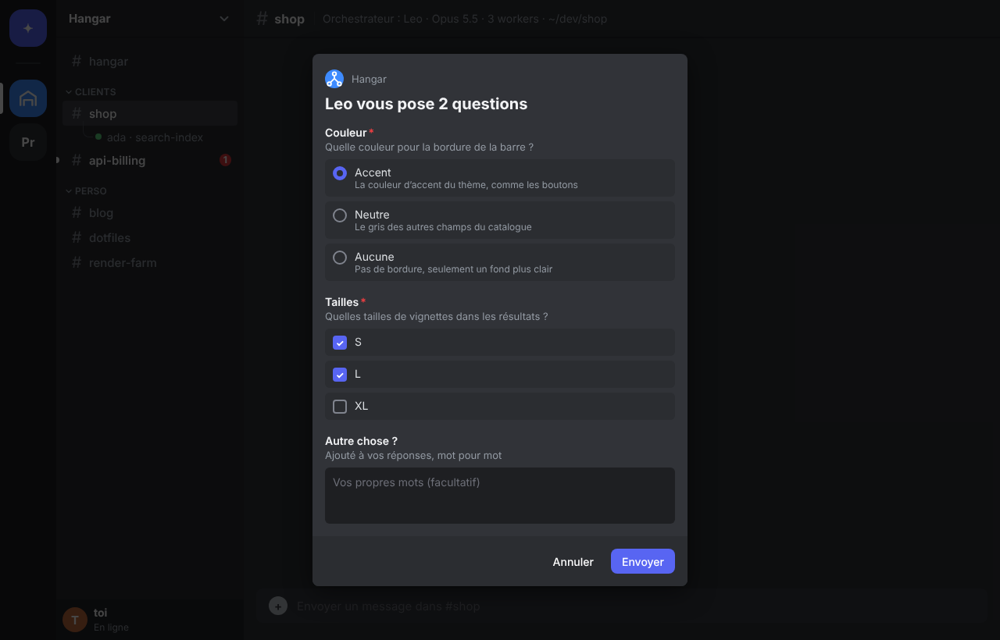
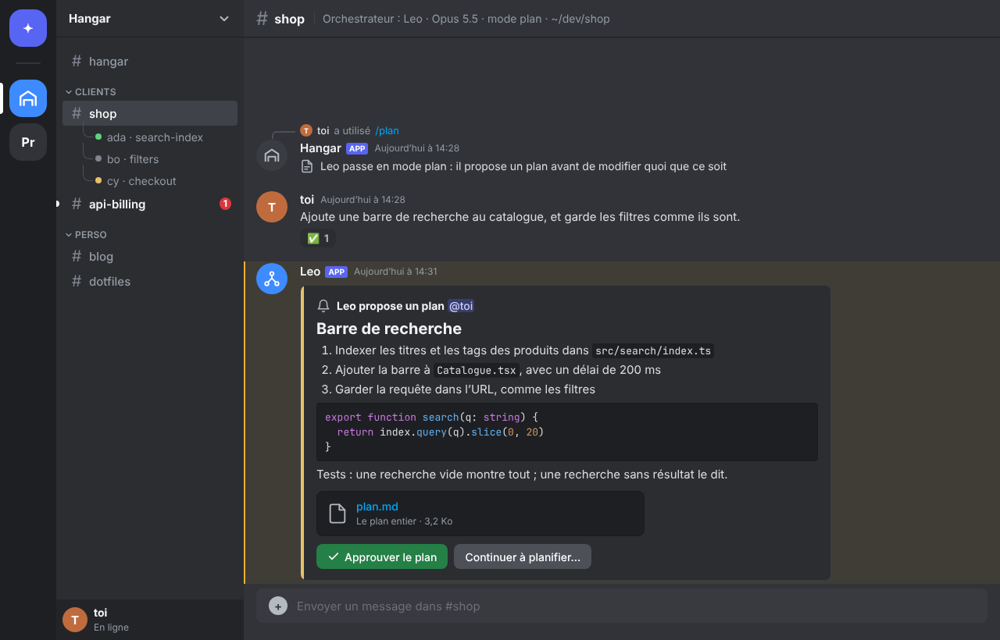
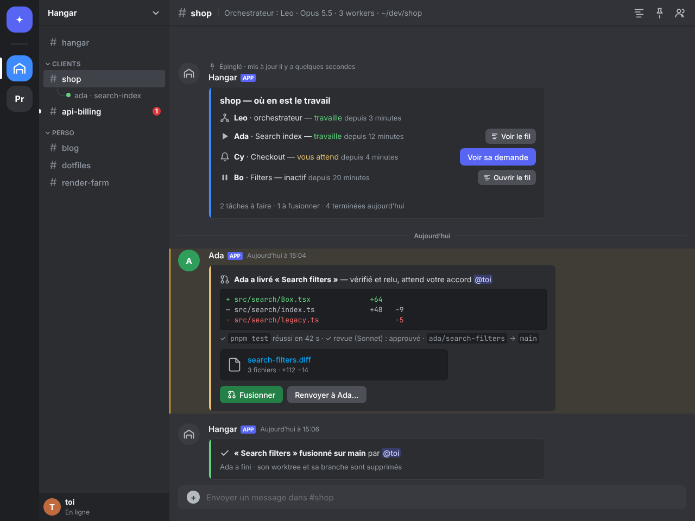
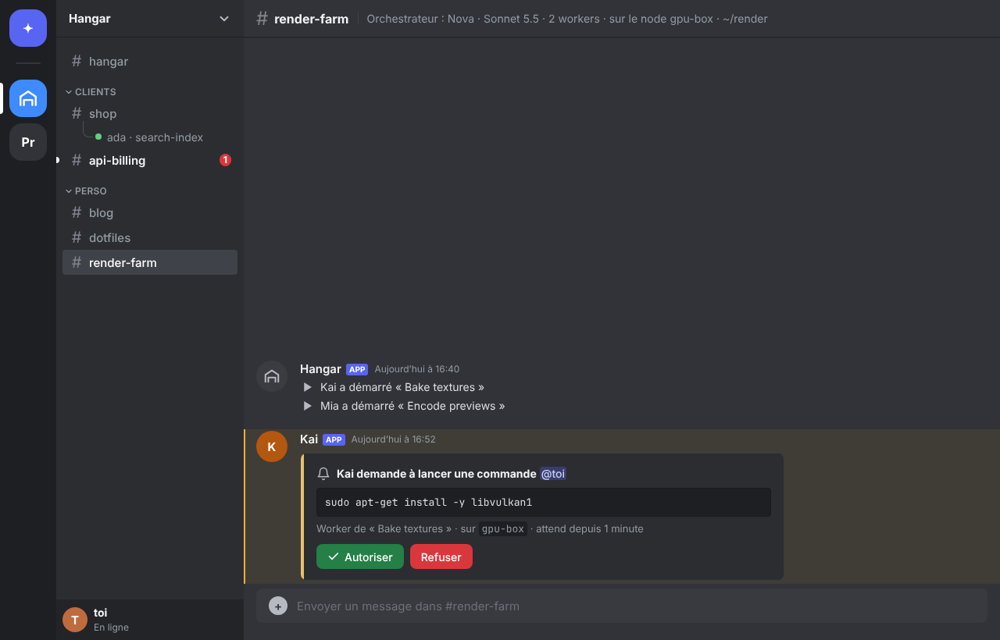
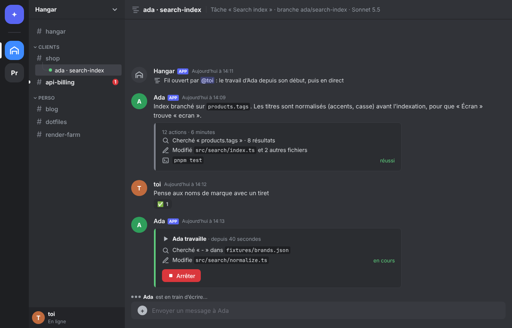

# Discord connector (experimental)

A Discord server as another surface of Hangar, for whoever would rather not
open the app: a category per folder, a channel per workspace (the
conversation with its orchestrator, as the chat view has it). The workers
stay out of the way: a line when one starts or delivers, their card when
they need the person, and a thread of their own only when the person opens
it with a button. A bot of the person's own reports what happens and
carries what the person says and decides back to the panes; only the person
is heard. It runs in the desktop app, beside Hangar Mobile, for the
workspaces the phone reaches (local, and those it drives on nodes); and in a
node with no desktop, for the workspaces the node runs itself. Built in
`crates/hangar-discord`; this is its design, the research it rests on, and
mockups of every card.

Experiment: `discord-connector` (Settings › Experimental), then Settings ›
Discord; on a node, `hangar-node discord setup` (headless.md, step 5).



## Where it runs

Beside a Hangar, whichever runs it (`hangar_discord::Hangar`): the
connector reads its snapshot, follows core's events (the mods' reports) and
the orchestration's journal, and acts through the desk (`mobile::desk`), the
chat view's and the phone's own calls: send, queue, answer a question,
allow a permission, approve a plan, stop, land or send back a delivery.
Every answer goes through the hangar-bridge mod as the chat view's do.

- **The desktop app** (`hangar-app/src/discord/`), behind the
  `discord-connector` experiment: the same port, desk and orchestration
  runtime as Hangar Mobile, so the server's channels are the workspaces the
  phone reaches, local and on the nodes the desktop drives. Settings ›
  Discord takes the bot's token and the server's id, shows the pairing code
  and the invite link; the settings are in the app's data folder
  (`discord/discord.json`, 0600). The bot answers while Hangar runs on the
  PC, window closed or not.
- **A node with no desktop** (`hangar-node serve`, headless.md step 3): the
  workspaces the node runs itself, with the PC off; set up with `hangar-node
  discord setup`.

**One bot for the desktop and its nodes.** Every instance of a bot hears
every event of the server, so several Hangars can share one: each makes and
answers its own channels, and the one that leads (`Hangar::leads`) answers
in the others it was not told are another's (`Hangar::others`): a command
typed in #general, a message before the pairing. Once the person is paired,
the desktop hands its settings to each node it is connected to (`PUT
/node/discord/shared`: the token, the server, the owner, the node's name);
the node's bot makes its channels in categories named after the node
(`Hangar · vps`) and answers in them, the PC on or off. The desktop leaves
those channels to it (`GET /node/discord` lists them) and leads; a node
leads while no desktop drives it. Disconnecting the desktop's bot takes it
back from the nodes (`DELETE /node/discord/shared`). A node set up with a
bot of its own (`hangar-node discord setup`) keeps it and refuses the
desktop's.

## Mapping

| Hangar | Discord |
|---|---|
| Folder | Category (up to 50 channels each) |
| Workspace, local or on a node | Text channel: the orchestrator's conversation |
| Worker | A line when it starts or delivers, and its permission, question or plan card in the workspace's channel when it needs the person, under its name. Its own thread, opened on demand: an « Ouvrir le fil » button on its line and on the dashboard |
| Agent (Leo, Ada…) | The bot's own webhook in the channel, with the agent's name and a generated avatar per message |
| Hangar's news | Short lines with Hangar's icons, as in the chat view |
| State of the workspace | One pinned dashboard card per channel, edited as it changes |

Decided with the person: a worker's thread only when opened with its
button; only the paired account is heard; workspaces on nodes are in.

## Messages: Components V2

Every message the bot sends uses Components V2 (message flag
`IS_COMPONENTS_V2`, `1 << 15`; it cannot be removed once set, and it
excludes `content`, `embeds`, `poll` and stickers).

| Component | Type | Used for |
|---|---|---|
| Container | 17 | Each card, its accent bar in Hangar's state colours: working `#5fd27f`, waiting `#e7c06b`, accent `#3e8bff`, failed, done grey |
| Text Display | 10 | Markdown: headings, lists, code with highlighting, `-#` subtext, mentions, `<t:…:R>` times |
| Section | 9 | 1–3 texts with a Button or a Thumbnail beside them: question options, dashboard rows |
| Separator | 14 | Spacing, with or without a line |
| File | 13 | `plan.md`, a delivery's `.diff` (`attachment://` only; 20 MiB) |
| Media Gallery | 12 | Screenshots (1–10 items) |
| Action Row + Button / selects | 1, 2, 3… | Up to 5 buttons, or one select of up to 25 options |

At most 40 components per message. Libraries cite about 4000 characters of
text per V2 message; the official docs do not state it: to confirm, and
split long answers below it at paragraph or code block boundaries.

Modals: a Label (18, label ≤ 45, description ≤ 100) around a Text Input,
a select, a File Upload (19), a Radio Group (21), a Checkbox Group (22) or a
Checkbox (23); 1–5 components, title ≤ 45. A modal is the answer to an
interaction only.

## The cards

**A turn.** One card per turn of the orchestrator, accent working: its calls
as compact lines with Hangar's icons (application emojis: an app owns up to
2000, usable anywhere), the model and context, and Stop. Edited at most every
~2 s while it runs; when the turn ends it folds to one line ("12 actions ·
6 minutes") and Claude's answer is a message of its own. `<t:start:R>`
("1 minute ago") updates on the client without an edit. While it works, the
typing indicator (`POST /channels/{id}/typing`, 10 s) is renewed.

**A permission.** Accent waiting, the command in a code block, Allow
(success) and Deny (danger), the person mentioned. Answered, the buttons
give way to "✅ Allowed by @you <t:…:R>" and the accent turns grey.



**A question.** One question: a Section per option with Choose beside it, or
a string select for several answers; "Other answer…" opens a modal. Several
questions (AskUserQuestion asks at most 4): "Answer the N questions…" opens
one modal, radio groups and checkbox groups plus a free text field.
twilight 0.18 has no Radio Group yet: a string select in a Label does the
same.



**A plan.** The plan as Markdown in a waiting card; past the text limit, an
excerpt and the whole plan as `plan.md`. Approve the plan, and Keep
planning… which opens a modal for what to change (the chat view's plan card,
`held::plan_decision`).



**A delivery.** Its files in a ```` ```diff ```` block (Discord colours `+`
lines green and `-` lines red), the check and the review, the branches, the
`.diff` as a File, and Land / Send back… (a modal for what to fix). Landed:
a green one-line card.

**The dashboard.** Pinned, edited at most every ~5 s: the orchestrator and
each worker with its state and since when, « Ouvrir le fil » or « Voir le
fil » beside each worker, a link to the card of whoever waits on the person,
and the counts of the board.



**A worker that needs the person.** Its card in the workspace's channel,
under its own name, saying which task it works on and, on a node, which
one; answered there like the orchestrator's.



**A worker's thread, opened on demand.** Nothing is opened by itself. A
worker's « started » line carries « Ouvrir le fil »; clicking it starts a
public thread on that line (`POST /channels/{id}/messages/{id}/threads`, the
thread's id is the line's), named after the worker and its task
(`ada · search-index`). The thread is filled with the worker's work since
its start, the way the chat view reads a transcript (its answers, one
folded card per turn), then follows it live; the line's button becomes
« Voir le fil » (a link button to the thread), and so does the
dashboard's. What the person writes in the thread goes to that worker (its
queue while it works), and the commands there are for it (`/stop`,
`/model`…). Its permission, question and plan cards still come in the
workspace's channel, where the person is called. When the worker's work
ends (landed, stopped, closed) the thread gets a last line and is archived;
opened again from the dashboard, it is unarchived. A worker on a node opens
the same way.



**Commands.** Registered on the guild only (so they show at once):
`/stop`, `/model`, `/effort`, `/plan`, `/status` (ephemeral), for the
channel's orchestrator, or in a worker's thread for that worker.

## What the person writes

Read with the `MESSAGE_CONTENT` intent (privileged; a toggle in the
Developer Portal under 10,000 users). Sent while the agent works, it waits
in the bridge queue: the bot reacts ⏳, then ✅ when it is taken. Deleting
the Discord message takes it back from the queue; editing it changes what
waits. Only the paired account is heard: anyone else's messages are
ignored, and their clicks get an ephemeral "only … can answer here".

## Interactions

Answer within 3 s or the interaction fails: a button that reaches the pane
is acknowledged at once with `DEFERRED_UPDATE_MESSAGE` (6), then the message
is edited (the token lasts 15 minutes). `UPDATE_MESSAGE` (7) where the new
card is known at once; `MODAL` (9) for the forms.

## Notifications

Work in progress is sent with `SUPPRESS_NOTIFICATIONS` (`1 << 12`). Only what
waits on the person mentions them (permission, question, plan, delivery
ready), with `allowed_mentions` limited to them: a push from Discord then
means something.

## Setup and security

- The person creates the Discord application and its bot, and the server: bots
  cannot create guilds since July 2025. `hangar-node discord setup --guild
  <id>` takes the token (from `HANGAR_DISCORD_TOKEN` or standard input) and
  gives the invite link with the
  scopes `bot applications.commands` and the permissions it needs (Manage
  Channels, Manage Webhooks, Send Messages, Create Public Threads, Send
  Messages in Threads, Embed Links, Attach Files, Read Message History, Add
  Reactions, Use External Emojis, Pin Messages, a separate permission since
  February 2026). The bot archives the threads it started without Manage
  Threads: their creator may.
- The bot token stays on the server, in `discord.json` (0600) beside the
  node's state.
- Pairing: `setup` prints a code (`hangar-node discord status` again), the
  person sends `pair <code>` in a channel the bot sees; only that Discord
  account is heard afterwards. A private server is recommended: a
  message there can run commands on the PC.
- Channel obfuscation (mandatory from November 16, 2026): a bot no longer
  sees channels it cannot view, so Hangar gives itself explicit access on the
  categories it creates.

## Limits to respect

- Rate limits: read the response headers rather than hard-coding them;
  50 requests/s globally; 10,000 invalid requests (401, 403, 429) in
  10 minutes ban the IP for a while.
- No streaming: a message per answer of Claude's, the turn card edited in
  batches.
- Renaming a channel is heavily limited (about twice per
  10 minutes, community knowledge, not in the docs): no state in names; the
  state lives in the cards and the dashboard.
- Threads archive after inactivity (60, 1440, 4320 or 10080 minutes): a
  worker's thread is opened with 10080 (a week) and a webhook message with
  `thread_id` unarchives it; the guild's active threads are limited (1000),
  which threads opened by hand stay far from.
- Webhook names cannot contain `clyde` or `discord`; a webhook the
  application created can send interactive components, others cannot.

## Implementation

`crates/hangar-discord`, a thin client of Discord's own rather than a
library: the REST calls the cards need (ureq, rustls) and the gateway
(tokio-tungstenite), with Components V2 written as JSON, so every component
Discord has (Label, Radio Group…) is there the day it is documented, and the
whole bot runs against a fake server in the tests. (twilight 0.18 has no
Radio Group; serenity 0.12.5 no Components V2.)

- `rest.rs`: the calls, as the bot or as a webhook; a 429 waited out and a
  spent route waited for (`X-RateLimit-Remaining: 0`).
- `gateway.rs`: Hello, Identify (guilds, guild messages, DMs, message
  content), heartbeats, Resume after a cut, a fresh session when Discord
  asks; a refused token or intent stops it with why.
- `cards.rs`: the turn, the answer (cut under ~3800 characters at
  paragraphs, a code block closed and reopened across a cut), the
  permission, the questions (one: a section per option; several: a modal of
  selects), the plan (an excerpt and `plan.md` past 3000 characters), the
  settled card, the worker's line with « Ouvrir le fil » / « Voir le fil »,
  the delivery, the dashboard. `ids.rs`: what a click acts on, in its
  `custom_id`.
- `lanes.rs`: what waits on Discord, in order per agent, channel and
  workspace, side by side between them ("Under load").
- `bot.rs`: the server's structure (a category per folder, made with the
  bot's own access; a channel and a webhook per workspace; the dashboard,
  pinned), the slash commands on the guild. `follow.rs`: the turns, the
  answers read whole from the transcript, the asks (`desk::pending_now`),
  the journal (workers, deliveries ready, tasks that need the person).
  `act.rs`: messages, clicks, modals, commands, the workers' threads.
- `words.rs`: French or English, after the settings' language.
- Its files beside the node's state: `discord.json` (token, server, owner,
  pairing code; 0600) and `discord-layout.json` (categories, channels,
  webhooks, dashboards, workers' lines and threads).

Tested against a fake Discord (`tests/discord.rs`: its REST routes and its
gateway): the bot identifies, makes the category, the channel, the webhook
and the pinned dashboard, is paired by the code, carries the owner's
message to the orchestrator and ignores anyone else's, shows a turn (card,
call, folded, the answer under the agent's name), posts a permission that
calls the owner, refuses a stranger's click and acknowledges the owner's,
shows a worker's line, opens its thread on that line and links to it,
carries a message in the thread to the worker, archives the thread when the
worker stops, and makes a workspace from `/workspace`; a message queued
while the agent works, edited, then deleted; and a desktop and its node
sharing one bot, each answering once in its own channels and the desktop
where neither made one. A run against discord.com needs the person's bot.

Each agent speaks with a face of its own: one of Discord's default
avatars, picked from its name (nothing of it goes elsewhere). What the
person writes while the agent works waits in its queue (⏳, then ✅ once
taken); editing the Discord message changes what waits, deleting it takes
it back (the queue's entries come with core's `BridgeQueue` events, so a
pane on a node the desktop drives is not followed this way).

`cargo run -p hangar-discord --example fake_discord -- 7777` serves a
Discord of one's own (its REST routes, its gateway, `/fake/calls` and
`/fake/send`); a debug build of the app talks to it with
`HANGAR_DISCORD_API=http://127.0.0.1:7777/api` and
`HANGAR_DISCORD_GATEWAY=ws://127.0.0.1:7777/gateway`. Run so (November 12,
2026), the desktop app made its category, channel, webhook and pinned
dashboard, typed a message written on "Discord" into its orchestrator's
pane, answered `/status`, and ignored a stranger.

## Under load

What waits on Discord is kept in order where order matters and side by
side elsewhere (`lanes.rs`): each agent's turn (its card posted, edited,
folded, its answer), each channel the person writes in (two messages sent
one after the other reach the agent in that order), each workspace (its
journal, its dashboard) is a lane of its own. The loop that hears the
gateway and the task that hears core wait on none of it, so a burst of the
mods' reports is neither missed (core keeps a thousand events for who lags)
nor slowed by Discord's answers; what a tick asks again (a dashboard, an
ask looked at) is not given twice to a lane that is slow. The server's
channels are made at once, its categories one after the other. A pane's ask
is read from its transcript only when its mod reported something since the
last look (a card up with nothing reported still stands, and is looked at
again every 15 s). The gateway's connection and the task that hears core
end with the bot (a bot started again leaves no connection behind).

`cargo bench -p hangar-discord --bench bot` (benches/bot.rs) runs the bot
against the fake Discord, answering each call after 150 ms as Discord does
from a server far from it, with sixteen agents working at once, each
through three turns of thirty tool calls, their reports arriving at 800 a
second (2,976 in 3.7 s). Measured on November 12, 2026 (4-core Xeon at
2.1 GHz, one run of each):

| | Before | After |
|---|---|---|
| The server made for 16 workspaces (68 calls) | 10.3 s | 1.1 s |
| Answers that reached the server | 33 of 48 | 48 of 48 |
| Turn cards folded | 24 of 48 | 48 of 48 |
| Everything there | never: reports were missed | 0.2 s after the last report |
| 64 agents, 4,000 reports a second, Discord answering in 300 ms | not run | 192 of 192, 0.3 s after the last report |

Before, the loop waited on each call to Discord while the reports queued
behind it, past what core keeps. A long answer is cut at 450 to 570 MB/s
and a turn's card built in 7 µs: neither is where the time goes.

## Sources

The official documentation, read from
[discord/discord-api-docs](https://github.com/discord/discord-api-docs)
(commit `36adecb`, November 10, 2026): `components/reference`,
`change-log`, `resources/message`, `resources/webhook`, `resources/channel`,
`topics/rate-limits`, `interactions/receiving-and-responding`.

## Mockups

`docs/images/discord/mockups.html` draws the seven screens above in a page
styled after Discord's dark theme; `node docs/images/discord/shoot.cjs` turns
them into the PNGs. They are mockups, not screenshots of Discord.
